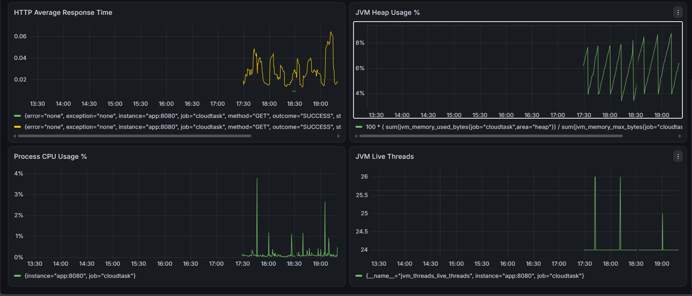
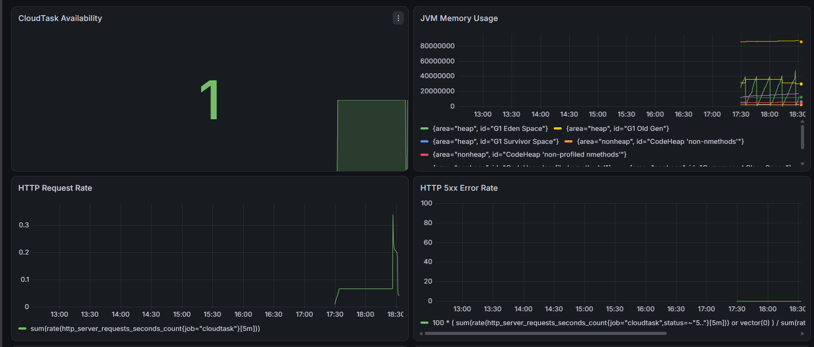

# ☁️ CloudTask

CloudTask is a production-oriented RESTful Task Management API built with Spring Boot. It demonstrates how to build, secure, test, containerize, deploy, and monitor a real-world backend application.

The system provides REST APIs for task management, authentication, authorization, audit logging, and administration, with PostgreSQL persistence, Flyway migrations, Docker, GitHub Actions CI/CD, AWS EC2 deployment, Prometheus metrics, and Grafana monitoring.

---

## 📋 Table of Contents

- [Overview](#-overview)
- [Architecture](#️-architecture)
- [Tech Stack](#️-tech-stack)
- [Key Features](#-key-features)
- [System Design](#-system-design)
- [Getting Started](#-getting-started)
- [Profiles](#-profiles)
- [API Documentation](#-api-documentation)
- [Testing](#-testing)
- [Observability](#-observability)
- [CI/CD](#-cicd)
- [AWS EC2 Deployment](#-aws-ec2-deployment)
- [Project Structure](#-project-structure)
- [Interview Talking Points](#-interview-talking-points)
- [Future Enhancements](#-future-enhancements)

---

## 🎯 Overview

CloudTask is designed as a production-oriented monolithic backend for secure task management.

### Core Goals

- Build a layered Spring Boot REST API
- Implement secure JWT authentication and authorization
- Enforce user ownership and data isolation
- Persist data reliably with PostgreSQL and Flyway
- Protect APIs with rate limiting
- Validate behavior with unit and integration testing
- Automate CI/CD using GitHub Actions
- Deploy the application to AWS EC2 using Docker Compose
- Monitor the application using Actuator, Prometheus, and Grafana

---

## 🏗️ Architecture

CloudTask follows a layered architecture with security, persistence, CI/CD, and observability around the application.

```text
┌─────────────────────────┐
│        Client           │
│  REST API / Swagger UI  │
└────────────┬────────────┘
             │ HTTP
             ▼
┌─────────────────────────┐
│   Spring Boot API       │
│                         │
│ JWT Authentication      │
│ Rate Limit Filter       │
│ Spring Security         │
│ Controllers             │
│ Services                │
│ Repositories            │
└───────┬─────────┬───────┘
        │         │
        │         └─────────────────────┐
        ▼                               ▼
┌───────────────────┐        ┌────────────────────┐
│    PostgreSQL     │        │ Spring Boot        │
│                   │        │ Actuator / Metrics │
│ JPA / Hibernate   │        └─────────┬──────────┘
│ Flyway Migrations │                  │
└───────────────────┘                  ▼
                              ┌────────────────────┐
                              │    Prometheus      │
                              │ Metric Collection  │
                              └─────────┬──────────┘
                                        │
                                        ▼
                              ┌────────────────────┐
                              │      Grafana       │
                              │ Monitoring Dashboard│
                              └────────────────────┘
```

### Deployment Architecture

```text
┌──────────────┐
│    GitHub    │
└──────┬───────┘
       │
       ▼
┌──────────────────────┐
│ GitHub Actions CI    │
│ Build + Test         │
└─────────┬────────────┘
          │ success
          ▼
┌──────────────────────┐
│ GitHub Actions CD    │
│ SSH Deployment       │
└─────────┬────────────┘
          │
          ▼
┌─────────────────────────────────┐
│           AWS EC2               │
│                                 │
│        Docker Compose           │
│                                 │
│ ┌─────────────┐ ┌────────────┐ │
│ │ CloudTask   │ │ PostgreSQL │ │
│ │ API :8080   │ │    :5432   │ │
│ └──────┬──────┘ └────────────┘ │
│        │                        │
│        ▼                        │
│ ┌─────────────┐ ┌────────────┐ │
│ │ Prometheus  │ │  Grafana   │ │
│ │    :9090    │ │   :3000    │ │
│ └─────────────┘ └────────────┘ │
└─────────────────────────────────┘
```

---

## 🛠️ Tech Stack

| **Category** | **Technology** | **Purpose** |
|---|---|---|
| **Language** | Java 21 | Application development |
| **Backend** | Spring Boot 3 | REST API and application framework |
| **Web** | Spring Web / Tomcat | HTTP and REST endpoints |
| **Security** | Spring Security | Authentication and authorization |
| **Authentication** | JWT | Stateless access-token authentication |
| **Refresh Tokens** | JWT refresh-token flow | Access-token renewal |
| **Password Security** | BCrypt | Password hashing |
| **Database** | PostgreSQL 18 | Persistent relational storage |
| **Persistence** | Spring Data JPA / Hibernate | ORM and data access |
| **Migration** | Flyway | Version-controlled database migrations |
| **Validation** | Jakarta Validation | Request validation |
| **API Documentation** | OpenAPI / Swagger UI | Interactive API documentation |
| **Rate Limiting** | Bucket4j | Per-user token-bucket rate limiting |
| **Audit Logging** | Custom audit logging | User activity and request auditing |
| **Unit Testing** | JUnit 5 / Mockito | Isolated business-logic testing |
| **Integration Testing** | Spring Boot Test / Testcontainers | Full application and database integration testing |
| **Containerization** | Docker | Application containerization |
| **Orchestration** | Docker Compose | Local and EC2 multi-container deployment |
| **CI/CD** | GitHub Actions | Automated build, test, and deployment |
| **Cloud** | AWS EC2 | Application hosting |
| **Monitoring** | Spring Boot Actuator | Health and application metrics |
| **Metrics** | Micrometer / Prometheus | Metrics instrumentation and collection |
| **Visualization** | Grafana | Monitoring dashboards |
| **Build Tool** | Maven | Dependency and build management |

---

## ✨ Key Features

### 1. **Task Management**

- Create, retrieve, update, and soft-delete tasks
- Task ownership
- Task priority and status
- Pagination
- Sorting
- Dynamic filtering using JPA Specifications
- Search across multiple task fields

### 2. **Authentication & Authorization**

- User registration
- User login
- JWT-based authentication
- Refresh tokens
- Role-based authorization
- `USER` and `ADMIN` roles
- BCrypt password hashing
- Ownership validation for protected resources

### 3. **Security**

- Spring Security
- JWT authentication filter
- User ownership enforcement
- Collection-level task isolation
- Per-user rate limiting with Bucket4j
- Correct `401`, `403`, `404`, and `429` HTTP behavior

### 4. **Audit Logging**

- Audit logging for important actions
- User activity tracking
- IP address capture
- User-Agent capture
- Request context handling

### 5. **Database & Persistence**

- PostgreSQL
- Spring Data JPA
- Hibernate
- Flyway database migrations
- JPA auditing
- Soft delete
- Persistent Docker volume

### 6. **Testing**

- JUnit 5 unit tests
- Mockito-based service tests
- Spring Boot integration tests
- PostgreSQL integration testing with Testcontainers
- Authentication and JWT integration testing
- Task ownership and authorization integration testing
- Rate-limit integration testing
- Actuator health endpoint testing
- Meaningful coverage focused on important behavior and security boundaries

### 7. **CI/CD**

- GitHub Actions CI
- Automated Maven build and test execution
- Continuous deployment after successful CI
- SSH-based EC2 deployment
- `git fetch` + `git reset --hard origin/main`
- Docker Compose rebuild and startup
- Post-deployment application health checks
- Deployment failure when the application does not become healthy

### 8. **Observability**

- Spring Boot Actuator
- `/actuator/health`
- `/actuator/prometheus`
- Prometheus metric collection
- Grafana dashboards
- Application availability monitoring
- HTTP request-rate monitoring
- HTTP 5xx error-rate monitoring
- HTTP response-time monitoring
- JVM memory and heap monitoring
- Process CPU monitoring
- JVM live-thread monitoring
- Failure and recovery verification

---

## 🔧 System Design

### Request Flow

```text
Client
  │
  ▼
JWT Authentication
  │
  ▼
Rate Limit Filter
  │
  ▼
Spring Security
  │
  ▼
Controller
  │
  ▼
Service
  │
  ▼
Repository
  │
  ▼
PostgreSQL
  │
  ▼
HTTP Response
```

### Authentication Flow

```text
Client
  │
  ├── POST /auth/register
  │
  └── POST /auth/login
           │
           ▼
      Authentication
           │
           ▼
      Access Token
           │
           ▼
  Authorization: Bearer <JWT>
           │
           ▼
      Protected API
```

### Refresh Token Flow

```text
Access Token Expires
        │
        ▼
POST /auth/refresh
        │
        ▼
Validate Refresh Token
        │
        ▼
Issue New Token Pair
```

### Rate Limiting Flow

```text
Authenticated Request
        │
        ▼
   RateLimitFilter
        │
        ▼
   User ID Bucket
        │
        ▼
Token Available?
   │          │
  YES         NO
   │          │
   ▼          ▼
Continue    HTTP 429
Request     Retry-After
```

---

## 🚀 Getting Started

### Prerequisites

- Java 21
- Docker
- Docker Compose
- Git
- Maven Wrapper included in the project

### Clone the Repository

```bash
git clone https://github.com/mkalki/cloud-task-api.git
cd cloud-task-api
```

### Environment Variables

Create a `.env` file in the project root:

```env
POSTGRES_DB=cloudtask
POSTGRES_USER=cloudtask
POSTGRES_PASSWORD=your_database_password

JWT_SECRET=your_long_random_jwt_secret
```

Never commit `.env` to GitHub.

Add this to `.gitignore`:

```text
.env
```

---

## 🐳 Running with Docker

Build and start the application stack:

```bash
docker compose up -d --build
```

Check running containers:

```bash
docker compose ps
```

View CloudTask logs:

```bash
docker compose logs app
```

Stop the stack:

```bash
docker compose down
```

The PostgreSQL data is stored in a persistent Docker volume.

To remove the database volume as well:

```bash
docker compose down -v
```

> **Warning:** `docker compose down -v` deletes the PostgreSQL volume and its stored database data.

Redis runs inside the Compose network with AOF persistence (`redis_data` volume) and no published host port. To reach it from your machine while debugging, add the dev override, which publishes it on `127.0.0.1:6379` only:

```bash
docker compose -f compose.yaml -f compose.dev.yaml up -d
```

---

## 🧩 Profiles

One codebase and one Docker image run in three roles, selected with Spring profiles:

| **Profile** | **Role** |
|---|---|
| `api` | REST API (auth, tasks, jobs) |
| `scheduler` | Releases due jobs to the Redis ready queue and rebuilds the queues from PostgreSQL (F2) |
| `worker` | Claims jobs from Redis and runs them (F3a) |

With no profile set, the app runs as `api,scheduler` (`spring.profiles.default`), so the current deploy and tests behave as before. To pick roles explicitly:

```bash
SPRING_PROFILES_ACTIVE=worker java -jar cloud-task.jar
```

The `scheduler` role runs the promote loop and the reconciler (see "Scheduler" below). The `worker` role starts one worker (see "Worker" below). The `api` role class still holds no logic.

Redis connection settings:

| **Env var** | **Default** |
|---|---|
| `REDIS_HOST` | `localhost` (`redis` in Compose) |
| `REDIS_PORT` | `6379` |

`/actuator/health` reports `db` and `redis` separately. If Redis is down, overall health is `DOWN` (HTTP 503) but `/tasks` keeps working.

---

## 📚 API Documentation

CloudTask uses OpenAPI and Swagger UI for interactive API documentation.

Swagger UI provides:

- REST endpoint discovery
- Request and response schemas
- Interactive endpoint testing
- JWT authorization support

### Local

```text
http://localhost:8080/swagger-ui/index.html
```

### AWS EC2

```text
http://<EC2_PUBLIC_IP>:8080/swagger-ui/index.html
```

---

## 🔐 REST API

### Authentication Endpoints

| **Method** | **Endpoint** | **Description** |
|---|---|---|
| POST | `/auth/register` | Register a new user |
| POST | `/auth/login` | Authenticate and receive tokens |
| POST | `/auth/refresh` | Refresh an access token |

### Task Endpoints

| **Method** | **Endpoint** | **Description** |
|---|---|---|
| GET | `/tasks` | Get tasks belonging to the authenticated user |
| POST | `/tasks` | Create a new task |
| GET | `/tasks/{id}` | Get a task by ID |
| PUT | `/tasks/{id}` | Update a task |
| DELETE | `/tasks/{id}` | Soft-delete a task |

Protected endpoints require:

```http
Authorization: Bearer <JWT_TOKEN>
```

### Job Endpoints

Jobs are background work items. A submitted job moves `PENDING` -> `QUEUED` when its run time arrives (scheduler), then `RUNNING` -> `SUCCEEDED` or `DEAD` when a worker runs it. Without a process in the `worker` role a job stays `QUEUED`. Retries and the reaper for crashed workers arrive in F4; until then any failure ends in `DEAD`. Job endpoints live under `/api/v1` like the others.

| **Method** | **Endpoint** | **Description** |
|---|---|---|
| POST | `/jobs` | Submit a job. Returns `201`, or `200` with the original job when the `Idempotency-Key` header was already used |
| GET | `/jobs` | List your jobs without their payloads. Supports `page`, `size` (1-100), `sort` (`createdAt`, `updatedAt`, `runAt`, `priority`, `status`, `type`, optionally `,asc` or `,desc`), `status`, `type` |
| GET | `/jobs/{id}` | Get one job with its attempts. Other users' jobs return `404` |
| POST | `/jobs/{id}/cancel` | Cancel a job that has not finished. Cancelling twice is a no-op; finished jobs return `409` |

Submit request body:

```json
{
  "type": "demo.work",
  "payload": { "durationMs": 500 },
  "priority": 5,
  "delaySeconds": 60,
  "maxAttempts": 3,
  "timeoutSeconds": 300
}
```

Only `type` is required. Use `runAt` (ISO-8601 UTC) or `delaySeconds`, not both. Valid types are the registered handlers (currently `demo.work`).

| **Rule** | **Result** |
|---|---|
| Unknown type, out-of-range field, `runAt` more than 365 days ahead | `400` |
| Payload larger than 64 KB, or request body larger than 72 KB | `413` |
| Missing or invalid token | `401` |
| Too many requests, or the active-job limit is reached | `429` |

Notes on responses:

- `GET /jobs` rows omit `payload` and `attempts`. Read them from `GET /jobs/{id}`.
- `413` can come before `401`. The request-size filter runs before authentication, so an oversized body is refused without a token check and never reaches the JSON parser.
- A retry with an `Idempotency-Key` that already created a job returns `200` with that job, even when the user is at the active-job limit. Only a new key gets `429`.
- An unknown job `type` returns `400` listing the valid types; the submitted value is not echoed back.

Job settings (defaults shown):

| **Property** | **Default** | **Meaning** |
|---|---|---|
| `cloudtask.jobs.max-active-per-user` | `1000` | Most BLOCKED, PENDING, QUEUED or RUNNING jobs one user may hold |
| `cloudtask.jobs.max-payload-bytes` | `65536` | Largest accepted payload (serialized JSON) |
| `cloudtask.jobs.max-schedule-ahead-days` | `365` | Furthest in the future a job may be scheduled |
| `cloudtask.request-size.rules[n].method` / `.path` / `.max-size` | `POST` `/api/v1/jobs` `72KB` | Largest request body per path. Bodies above it get `413` before they are parsed. Setting any rule replaces the default list |

### Scheduler

PostgreSQL is the source of truth. Redis holds two queues that can be rebuilt at any time (ADR 002):

| **Redis key** | **Type** | **Content** |
|---|---|---|
| `jobs:scheduled` | sorted set | member `priority:jobId`, score = run time in epoch ms |
| `jobs:ready` | sorted set | member `jobId`, score = `(9 - priority) * 10^14 + epoch ms`, so priority 9 comes first and equal priorities are first in, first out |
| `jobs:processing` | sorted set | member `jobId`, score = lease deadline in epoch ms. Written by workers |

- **Submit** commits the row, then adds the job to `jobs:scheduled`. If Redis is down the request still succeeds and the reconciler adds the job later.
- **Promote** runs every `poll-interval`. One Lua script moves due jobs from `jobs:scheduled` to `jobs:ready`. The scheduler then runs `UPDATE ... WHERE status = 'PENDING'` to set `QUEUED`. Several scheduler instances may run at once; each job is moved once.
- **Cancel** sets the row to `CANCELLED` first, then removes the job from Redis. A cancelled row is never promoted, even if the Redis removal failed.
- **Reconcile** runs at startup and every `reconcile-interval`. It writes every `PENDING` row to `jobs:scheduled` and every `QUEUED` row that is in neither `jobs:ready` nor `jobs:processing` to `jobs:ready`. After `FLUSHALL` on Redis nothing is lost.
- Low-priority jobs can wait indefinitely while higher-priority jobs keep arriving. This is accepted.

| **Property** | **Default** | **Meaning** |
|---|---|---|
| `cloudtask.scheduler.enabled` | `true` | Turns the promote loop and periodic reconciler off (tests use this) |
| `cloudtask.scheduler.poll-interval` | `PT1S` | Pause between promote runs |
| `cloudtask.scheduler.promote-batch-size` | `100` | Most jobs moved per promote run |
| `cloudtask.scheduler.reconcile-interval` | `PT60S` | Pause between reconcile runs |
| `cloudtask.scheduler.reconcile-batch-size` | `500` | Rows read per page while reconciling |

### Worker

A process started with `SPRING_PROFILES_ACTIVE=worker` runs one worker (ADR 003). It claims jobs, runs their handler and writes the result. Several workers can run at once, on one machine or many.

1. **Claim.** `claim.lua` takes the best id from `jobs:ready` and adds it to `jobs:processing` with score = now + lease, in one atomic step. Then one SQL update moves the row `QUEUED` -> `RUNNING` (`attempt` + 1, `locked_by`, `lease_expires_at`, `started_at`). If it changes no row (the job was cancelled, or is still `PENDING` because the promoter had not finished), the worker removes the id from `jobs:processing` and moves on. The reconciler brings a still-`PENDING` job back within its interval (60 s by default).
2. **Lease.** While the handler runs, every `lease-ms / 3` the worker extends the deadline in Redis (`renew_lease.lua`, returns 1 or 0) and in the database. If either says the job is no longer held, the handler is interrupted and no result is reported.
3. **Result.** `UPDATE ... WHERE id = ? AND status = 'RUNNING' AND attempt = ? AND locked_by = ?`. A run whose lease was lost or whose job was cancelled matches no row: its result is ignored, an attempt row with outcome `FENCED` is stored and the log says `fenced result ignored`. Success gives `SUCCEEDED`. Any failure or timeout gives `DEAD` with `last_error` (cut to 4 KB) until F4 adds retries.
4. **Attempts.** Every run writes one `job_attempts` row: worker, start, end, outcome (`SUCCEEDED`, `FAILED`, `TIMEOUT`, `FENCED`), error, duration.
5. **Timeout.** The handler runs in a `Future`. After `timeoutSeconds` it is cancelled with an interrupt and the attempt is `TIMEOUT`. Java cannot kill a thread: a handler that ignores interrupts keeps running. The fence still rejects its late result, and the lease runs out because the worker stops renewing it.
6. **Delivery is at-least-once.** A job can run twice after a crash or a lost lease, so handlers must be idempotent.

A worker takes a job only when it has a free slot, so a queue of 1000 jobs does not pile up inside one worker. When the queue is empty it polls every `poll-min-ms`, backing off to `poll-max-ms`. On shutdown it stops claiming and waits up to 5 s for running jobs; the rest are interrupted, report nothing and wait for their lease to expire (the reaper arrives in F4; `cloudtask.worker.shutdown-grace` arrives in F3c).

| **Property** | **Default** | **Meaning** |
|---|---|---|
| `cloudtask.worker.enabled` | `true` | Starts one worker in the `worker` profile (tests set `false` and create workers themselves) |
| `cloudtask.worker.concurrency` | `4` | Jobs one worker runs at the same time |
| `cloudtask.worker.lease-ms` | `30000` | How long a claim holds a job without renewal. Renewed every third of it |
| `cloudtask.worker.poll-min-ms` | `200` | Pause between polls right after work was found |
| `cloudtask.worker.poll-max-ms` | `1000` | Longest pause between polls while the queue is empty |

Run locally (after the API and Redis are up, with the same database settings as the API):

```bash
SPRING_PROFILES_ACTIVE=worker SERVER_PORT=8081 java -jar cloud-task.jar
```

The worker still starts the web server and security chain of the shared image, so it needs its own port when it shares a host with the API. The Compose worker service, its heartbeat and `GET /admin/workers` arrive in F3c.

Built-in handler in this release: `demo.work` with payload `{"durationMs": 0-60000, "failProbability": 0-1, "counterKey": "..."}`. All fields are optional and unknown fields are ignored. A bad value returns `400` at submit. `counterKey` is for tests: it counts runs and overlapping runs of the same key in Redis (`demo:counter:{ownerId}:{key}:runs|overlaps`, expire after 1 hour).

---

## 📝 Example Task Request

### Create Task

```text
POST /tasks
```

```json
{
  "title": "Deploy CloudTask",
  "description": "Deploy the application on AWS EC2",
  "priority": "HIGH"
}
```

Example response:

```json
{
  "id": 1,
  "title": "Deploy CloudTask",
  "description": "Deploy the application on AWS EC2",
  "status": "TODO",
  "priority": "HIGH",
  "ownerId": 1
}
```

---

## 🔎 Pagination, Filtering & Sorting

CloudTask supports pagination and sorting:

```text
GET /tasks?page=0&size=10
```

Dynamic filtering is implemented using JPA Specifications.

Supported capabilities:

- Pagination
- Sorting
- Dynamic filtering
- Searching across multiple task fields

---

## 🧪 Testing

CloudTask uses both **unit testing** and **integration testing**.

### Unit Testing

Unit tests focus on isolated service-layer business logic using:

- JUnit 5
- Mockito
- Mocked dependencies
- Behavior-focused assertions

### Integration Testing

Integration tests verify multiple real components working together.

The integration environment includes:

```text
MockMvc
   │
   ▼
Spring Security
   │
   ▼
Controller
   │
   ▼
Service
   │
   ▼
Repository
   │
   ▼
PostgreSQL Testcontainer
```

Integration coverage includes:

- Spring application context loading
- Authentication and JWT flows
- Refresh token behavior
- Logout/token revocation
- Task ownership
- Authorization boundaries
- Collection-level task isolation
- Unauthenticated access
- Rate limiting
- Actuator health

Run the complete test suite:

```bash
./mvnw test
```

The full suite has been verified successfully.

---

## 📈 Observability

CloudTask uses **Spring Boot Actuator + Micrometer + Prometheus + Grafana**.

### Actuator

Health endpoint:

```text
http://localhost:8080/actuator/health
```

Prometheus metrics:

```text
http://localhost:8080/actuator/prometheus
```

### Prometheus

Prometheus scrapes CloudTask every 15 seconds using:

```text
app:8080/actuator/prometheus
```

Prometheus is available locally at:

```text
http://localhost:9090
```

### Grafana

Grafana reads metrics from Prometheus and provides a monitoring dashboard.

Grafana is available locally at:

```text
http://localhost:3000
```

### Dashboard Panels

The CloudTask dashboard currently includes:

| **Panel** | **Purpose** |
|---|---|
| CloudTask Availability | Detect whether the application is reachable |
| JVM Memory Usage | Monitor JVM memory consumption |
| HTTP Request Rate | Monitor incoming request traffic |
| HTTP 5xx Error Rate | Monitor server-side failures |
| HTTP Average Response Time | Monitor request latency |
| JVM Heap Usage % | Monitor heap utilization |
| Process CPU Usage % | Monitor application CPU consumption |
| JVM Live Threads | Monitor JVM thread count |

### Observability Architecture

```text
CloudTask
    │
    ▼
Spring Boot Actuator
    │
    ▼
/actuator/prometheus
    │
    ▼
Prometheus
    │
    ▼
Grafana
    │
    ▼
CloudTask Monitoring Dashboard
```

### Failure and Recovery Verification

The monitoring setup was tested by stopping and restarting the CloudTask application container.

```text
Application Running
        │
        ▼
Prometheus up = 1
        │
        ▼
Stop CloudTask
        │
        ▼
Prometheus up = 0
        │
        ▼
Restart CloudTask
        │
        ▼
Prometheus up = 1
```

This verifies that the monitoring system can detect both application failure and recovery.

### Dashboard Configuration

The exported Grafana dashboard is stored in:

```text
grafana/dashboards/cloudtask-dashboard.json
```

### Grafana Dashboard





---

## 🔄 CI/CD

### Continuous Integration

GitHub Actions runs the project's automated build and test process.

```text
Git Push
   │
   ▼
GitHub Actions CI
   │
   ▼
Maven Build + Tests
```

### Continuous Deployment

Successful CI triggers deployment for pushes to `main`.

```text
Push to main
      │
      ▼
CI succeeds
      │
      ▼
CD workflow
      │
      ▼
SSH to EC2
      │
      ▼
git fetch origin
      │
      ▼
git reset --hard origin/main
      │
      ▼
docker compose up -d --build
      │
      ▼
Wait for application startup
      │
      ▼
GET /actuator/health
      │
   ┌──┴───┐
  UP      FAIL
   │        │
   ▼        ▼
Success   Deployment fails
```

The CD workflow also collects Docker status and recent application logs when the health check fails.

---

## ☁️ AWS EC2 Deployment

CloudTask is deployed to AWS EC2 using Docker Compose.

### Deployment Flow

```text
GitHub
   │
   ▼
GitHub Actions
   │
   ▼
AWS EC2
   │
   ▼
Docker Compose
   │
   ├── CloudTask API :8080
   ├── PostgreSQL    :5432
   ├── Prometheus    :9090
   └── Grafana       :3000
```

The application is available at:

```text
http://<EC2_PUBLIC_IP>:8080
```

Swagger UI:

```text
http://<EC2_PUBLIC_IP>:8080/swagger-ui/index.html
```

The EC2 Security Group must allow the required inbound ports.

The deployment has been verified for:

- User registration
- User login
- JWT authentication
- Protected REST endpoints
- Task creation
- Task updates
- Task retrieval
- External access through the EC2 public IP
- PostgreSQL persistence after Docker restart
- Post-deployment health verification

---

## 📁 Project Structure

```text
cloud-task-api/
├── .github/
│   └── workflows/
│       ├── ci.yml
│       └── cd.yml
│
├── grafana/
│   └── dashboards/
│       └── cloudtask-dashboard.json
│
├── src/
│   ├── main/
│   │   ├── java/
│   │   │   └── com/
│   │   │       └── mkalki/
│   │   │           └── cloudtaskapi/
│   │   │               ├── audit/
│   │   │               ├── config/
│   │   │               ├── context/
│   │   │               ├── controller/
│   │   │               ├── dto/
│   │   │               ├── entity/
│   │   │               ├── exception/
│   │   │               ├── ratelimit/
│   │   │               ├── repository/
│   │   │               ├── security/
│   │   │               ├── service/
│   │   │               └── specification/
│   │   │
│   │   └── resources/
│   │       ├── application.properties
│   │       └── db/
│   │           └── migration/
│   │
│   └── test/
│
├── compose.yaml
├── Dockerfile
├── prometheus.yml
├── pom.xml
└── README.md
```

---

## 🎯 Interview Talking Points

### 1. **Why a layered architecture?**

Layer separation keeps responsibilities focused:

```text
Controller → Service → Repository → Database
```

This improves maintainability, testability, and separation of concerns.

### 2. **Why JWT?**

JWT provides stateless authentication:

- No server-side HTTP session required
- Token carries authenticated identity
- Works well for REST APIs
- Protected endpoints validate the token before access

### 3. **Why refresh tokens?**

Short-lived access tokens reduce exposure if an access token is compromised, while refresh tokens allow clients to obtain new access tokens without forcing frequent login.

CloudTask also supports refresh-token invalidation and reuse protection.

### 4. **Why Testcontainers for integration tests?**

Testcontainers allows the integration tests to run against a real PostgreSQL database rather than a mocked database.

This verifies real interactions across:

```text
Application
→ JPA
→ Hibernate
→ PostgreSQL
```

### 5. **Why meaningful integration testing instead of 100% coverage?**

The goal is to cover:

- Important application behavior
- Security boundaries
- Major success paths
- Important failure paths

Testing every possible parameter combination can increase maintenance cost without proportional value.

### 6. **Why Bucket4j for rate limiting?**

CloudTask uses a token-bucket model where each authenticated user gets a bucket keyed by user ID.

```text
User ID
   ↓
Bucket
   ↓
Token available → request allowed
No token       → 429
```

The production configuration currently allows 100 tokens with a 100-token refill over one minute.

### 7. **Why Prometheus and Grafana?**

Prometheus collects and stores numerical application metrics.

Grafana queries Prometheus and turns those metrics into dashboards.

```text
Application
   ↓
Actuator / Micrometer
   ↓
Prometheus
   ↓
Grafana
```

### 8. **Why health checks in CI/CD?**

A successful Docker startup does not necessarily mean the application is ready to serve traffic.

The CD workflow therefore verifies:

```text
Container Started
      ↓
Application Started
      ↓
/actuator/health
      ↓
Deployment Success
```

---

## 🚀 Future Enhancements

CloudTask v3 evolves the API into a distributed job orchestrator, delivered one feature at a time:

| **Feature** | **Scope** |
|---|---|
| F0 | Redis infrastructure, role profiles, shared Testcontainers setup |
| F1 | Job domain and submission API |
| F2 | Redis scheduler: delayed and priority jobs, reconciler |
| F3 | Worker runtime: atomic claim, leases, built-in handlers |
| F4 | Retries with backoff, dead-letter queue, crash recovery |
| F5 | Workflows (DAGs) |
| F6 | Real-time dashboard (WebSocket) |
| F7 | Observability: job metrics and Grafana panels |
| F8 | Scaling, chaos and load tests |
| F9 | Recurring (cron) jobs |
| F10 | Hardening and EC2 deploy |
| F11 | Docs and interview pack |

---

## 📝 License

CloudTask is currently an educational and portfolio-oriented backend project.

---

## 👤 Author

**Mohan R**
